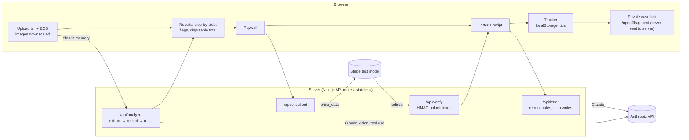

# BillCheck

**Check a US medical bill against your insurer's EOB in about 2 minutes, see what you can dispute, and get a ready-to-send letter, a phone script and deadlines.**
$19 per bill. No percentage of savings. No insurance or bank login.

Business Cup 2.0 · Track 01 — MONEY · B2C web app for working adults in the US (25–45).

- **Live demo:** https://financebro-zeta.vercel.app → click **Try a sample bill** (expect **$645**), or [the surprise anesthesia case](https://financebro-zeta.vercel.app/check?sample=2) (expect **$2,200**)
- No sign-up, no login. Test payments: card **4242 4242 4242 4242**, any future date, any CVC/ZIP.

---

## The problem

An insured American gets two documents for one visit, from two organizations: a **bill** from the provider and an **EOB** (Explanation of Benefits) from the insurer. They often don't match, the codes are unreadable, and most people just pay.

- 43% of all US adults — and 53% of those with medical debt — say they received a medical or dental bill they thought contained an error. ([KFF Health Care Debt Survey](https://www.kff.org/health-costs/issue-brief/could-consumer-assistance-be-helpful-to-people-facing-medical-debt/))
- 45% of insured working-age adults got a bill or copay in the past year for something they thought insurance should have covered. Fewer than half challenged billing errors; 54% of those who didn't were unsure they had the right to. Among those who disputed, 38% had the bill reduced or eliminated. (Commonwealth Fund, Aug 2024, via [HealthDay](https://www.healthday.com/))
- Insurance doesn't prevent bills: the average single deductible for job-based coverage is $1,886, and 34% of covered workers have $2,000+. ([KFF Employer Health Benefits Survey 2025](https://www.kff.org/health-costs/report/2025-employer-health-benefits-survey/))

**Who it's for:** privately insured working adults 25–45 — especially on high-deductible or family plans — who just received an unexpected bill of $300–$5,000.
Persona: *Jessica, 34, marketer in Ohio, HDHP through work, two kids. Her son's ER visit produced a $1,840 bill six weeks later.*

## What it does

1. **Upload** the itemized bill and the EOB (PDF, JPG, PNG or pasted text) — or press **Try a sample bill**.
2. **AI extracts** every line into strict JSON (Claude vision; validated with zod, one automatic retry). Names, member IDs and account numbers are masked.
3. **A deterministic rules engine** matches bill lines to EOB lines and applies 8 rules.
4. **Free results:** side-by-side bill vs. EOB with highlighted mismatches, every issue with confidence + source, and the amount you can dispute.
5. **$19 unlock (Stripe Checkout, test mode):** dispute letter to the billing office, insurer review request when relevant, phone script with escalation phrases, deadlines.
6. **Your details, locally:** the letter's `[Your name]`, `[Account number]`… placeholders are filled in the browser and never sent to the server.
7. **Dispute tracker** (no login, localStorage): status, call log, follow-up date with calendar (.ics) export, "You've saved $X", JSON export/import.
8. **English, Spanish and French:** a language picker in the header (English by default, saved in the browser). Flags, deadlines and server errors carry stable keys and parameters, so the whole flow is translated, while the dispute letter and phone script stay in English for US billing offices. Stripe Checkout opens in the same language.
9. **Private case link instead of an account:** the whole case (results, unlock, letter, tracker entry) is deflate-compressed into the URL fragment (`/open#…`). Browsers never send the fragment to a server, so the user can bookmark it or email it to themselves and open the case on any device while we still store nothing. Opened links are size-capped and validated with zod.

## Architecture

> **The LLM extracts. Deterministic rules decide.** The model never chooses a flag or a dollar amount.



- No database. Uploaded files are processed in memory and never written to disk or logs. Results and the tracker live in the user's browser.
- The unlock token is `HMAC-SHA256(UNLOCK_SECRET)` over `{scope, plan, exp, nonce}`. The scope is the **analysis id = SHA-256 of the extracted documents**, so a token for one bill can't unlock another (or an edited copy). `/api/letter` recomputes the flags server-side instead of trusting the client.
- In-memory IP rate limit: 10 analyses and 10 letters per hour.

### Rules (`src/lib/rules/`)

| Rule | When it fires | Amount at stake | Confidence |
|---|---|---|---|
| `DUPLICATE_CHARGE` | Same date + code (or description + amount) appears more often on the bill than on the EOB | Patient share of the extra line: EOB allowed amount if the deductible applies; else allowed × coinsurance; else billed (low) | high |
| `BILL_EXCEEDS_EOB` | Bill balance > total patient responsibility on the EOB(s) | The difference | high |
| `LINE_NOT_ON_EOB` | A charge with no matching EOB line | Line amount | medium |
| `NO_INSURANCE_APPLIED` | Bill shows $0 insurance paid/adjusted, but the EOB shows the claim was processed | Bill balance − EOB responsibility | high |
| `BALANCE_BILLING_IN_NETWORK` | The extra amount equals the in-network contractual discount (billed − allowed) | That amount | high |
| `POSSIBLE_SURPRISE_BILL` | Out-of-network emergency care, or out-of-network anesthesia/radiology/pathology/assistant surgeon at an in-network facility (No Surprises Act) | OON share − in-network estimate; full amount (low) if unknown | medium / low |
| `NOT_ITEMIZED` | No line-level detail | $0 — ask for an itemized bill | high |
| `POSSIBLE_UNBUNDLING` | Commonly bundled code pairs billed separately (framed as a question) | Line amount | low |

**Disputable total** counts each dollar once: claim-level flags (bill vs. EOB totals) and line-level flags describe the same money from two angles, so the total is `max(largest claim-level amount, sum of line-level amounts)`, high + medium only.

Matching (`src/lib/match.ts`): same service date + base CPT/HCPCS code (modifiers ignored); otherwise description similarity + same billed amount. Credits and adjustments are never matched or flagged.

### Sample cases (`public/samples/`, generated by `scripts/make-samples.ts`)

**1. ER bill** (`/check?sample=1`). Fictional ER visit at "Riverside General Hospital" with a "Summit Health Plan" EOB (HDHP, deductible not met). The bill charges the head CT twice and adds a $165 supply line insurance never saw; the balance is $1,840 vs. $1,195 on the EOB.

Expected and tested: `DUPLICATE_CHARGE` $480 (high) + `LINE_NOT_ON_EOB` $165 (medium) + `BILL_EXCEEDS_EOB` $645 (high) → **disputable total $645**, not $1,290. 

**2. Surprise anesthesia bill** (`/check?sample=2`). Laparoscopic appendectomy at an in-network hospital; the anesthesia group "Lakeshore Anesthesia Associates" is out-of-network. The insurer applied 40% out-of-network coinsurance ($560) and the group bills $2,760. Expected and tested: `BILL_EXCEEDS_EOB` $2,200 (high) + `POSSIBLE_SURPRISE_BILL` (low; $280 at medium confidence when the user enters 20% in-network coinsurance) → **disputable total $2,200**.

The live demo sends the real PDFs through the real pipeline — no canned results.

## Code map

| Path | What |
|---|---|
| `src/lib/schemas.ts` | zod schemas (BillDoc, EobDoc, Flag, Analysis…) with money normalization |
| `src/lib/match.ts`, `src/lib/rules/*` | Matcher and rules engine (pure functions) |
| `src/lib/anthropic.ts`, `src/lib/prompts/*` | Extraction via tool use (JSON-text fallback) + zod validation + one retry with the validation errors; prompts with comments |
| `src/lib/dispute.ts` | Letter/script generation; deadlines are rule-based |
| `src/lib/redact.ts`, `src/lib/hash.ts`, `src/lib/unlock.ts` | Masking, analysis id, HMAC tokens |
| `src/lib/case-link.ts`, `src/lib/placeholders.ts` | Private case links (compress + validate), letter placeholders |
| `src/lib/i18n/*` | `en.ts` (the shape), `es.ts`, `fr.ts`; flag/deadline/error translation helpers; client locale hook |
| `src/app/api/*` | `analyze`, `checkout`, `verify`, `letter` |
| `src/components/*` | Uploader, SideBySide, FlagCard, Paywall, DisputePackView, TrackerBoard, CaseLink |
| `tests/*` | Vitest (58 tests): every rule, both sample cases, matcher, tokens, redaction, case links, placeholders, translations (English templates match the server text exactly; every language has every message) |

## Payments

Stripe Checkout in **test mode** with inline `price_data` (no dashboard setup): "Fix this bill" $19 one-time, "Family plan" $59/year subscription. After the redirect, `/api/verify` asks Stripe whether the session is paid and returns a signed unlock token. Test card: **4242 4242 4242 4242**, any future date, any CVC, any ZIP. Without `STRIPE_SECRET_KEY` the paywall shows a setup error and never unlocks.

## Privacy

Files are processed in memory and never stored; server logs contain only error types, never document content. The extraction prompt replaces names with `[PATIENT]`/`[MEMBER]`, and `redact.ts` masks account/claim numbers to the last 4 characters and scrubs SSNs, phone numbers, long IDs and street addresses. We do **not** claim HIPAA compliance. Not legal or medical advice.

## Run locally

```bash
npm install
cp .env.example .env.local     # fill in the keys
npm run dev                    # http://localhost:3000
npm test                       # vitest
npm run samples                # regenerate the sample PDFs
```

| Variable | Required | Purpose |
|---|---|---|
| `ANTHROPIC_API_KEY` | yes | Claude extraction and letters (server only) |
| `ANTHROPIC_MODEL` | no | Defaults to `claude-sonnet-5-5` |
| `STRIPE_SECRET_KEY` | yes for paywall | `sk_test_...` |
| `UNLOCK_SECRET` | yes for paywall | Any random string, 32+ characters |
| `NEXT_PUBLIC_APP_URL` | no | Public URL for Stripe redirects; defaults to the request origin |

### Deploy to Vercel

1. Import this GitHub repo in Vercel (framework: Next.js, no settings needed).
2. Project → Settings → Environment Variables: add the variables above.
3. Redeploy. Open the URL → **Try a sample bill** → expect **$645**.

Limits: Vercel accepts request bodies up to ~4.5 MB, so uploads are capped at ~4 MB total; photos are downscaled in the browser first. HEIC isn't supported yet (export as JPG).

## Team

| Name | Role |
|---|---|
| Ruslan | Idea and concept |
| Danial | Product development |

## License

MIT
